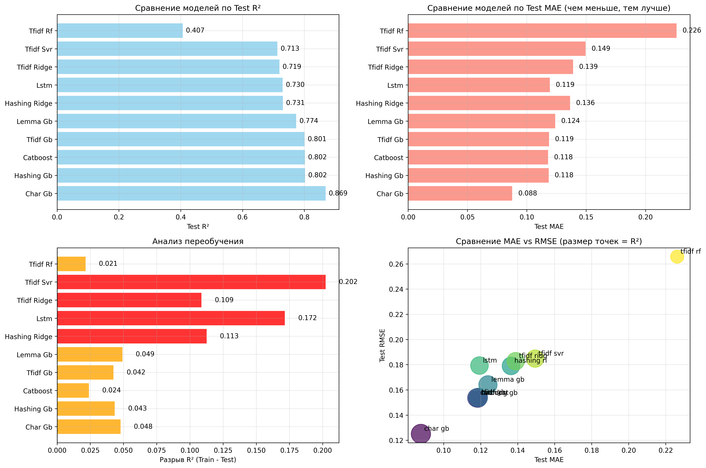
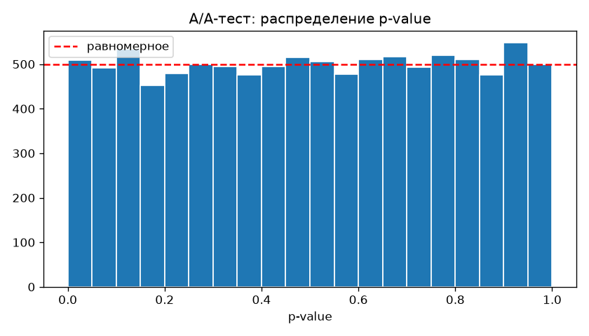
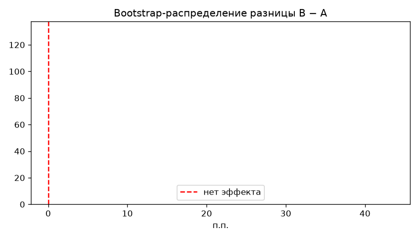

# Оценка информативности русскоязычных отзывов

Регрессия: по тексту отзыва о телефоне предсказать его **информативность** — число от 0 до 1. Сравниваются способы векторизации текста и модели: от линейных до градиентного бустинга и LSTM.

Командный проект (4 человека). Презентация с результатами — [`NLP.pptx`](NLP.pptx).

## Данные

- `data.csv` — 458 433 отзыва (`Review`, `Rating`).
- `informativeness.csv` — те же отзывы с целевой переменной `informativeness` ∈ [0, 1], сгенерированной по формуле:

  `informativeness = 0.35 × длина + 0.40 × тех. характеристики + 0.15 × опыт использования + 0.10 × структурированность`

  (скрипт генерации в репозиторий не входит).

Из 458 433 отзывов отбирается **стратифицированная выборка 30 000** (по значению информативности, чтобы сохранить распределение). После очистки остаётся 29 625 отзывов, разбиение train/test — 80/20, `random_state=42`.

Предобработка: нижний регистр, замена чисел, лет, денежных сумм и технических характеристик на токены (`NUM`, `YEAR`, `MONEY`, `TECH_SPEC`), удаление пунктуации и стоп-слов NLTK.

> CSV-файлы весят больше 300 МБ и не хранятся в репозитории (`.gitignore`). Положите их в корень проекта рядом с ноутбуком.

## Эксперименты (`informativeness.ipynb`)

1. **Турнир 1** — фиксированный TF-IDF (1–3-граммы) + разные регрессоры: Gradient Boosting, Random Forest, Ridge, SVR.
2. **Турнир 2** — фиксированный Gradient Boosting + разные векторизаторы: символьные n-граммы (3–5), стемминг (Snowball) + TF-IDF, HashingVectorizer.
3. **Турнир 3** — гибридные модели: HashingVectorizer + Ridge, TF-IDF + CatBoost.
4. **Нейросеть** — двунаправленная LSTM (словарь 20 000, длина 200, эмбеддинги 128) с EarlyStopping.
5. **Сводный анализ** — рейтинг по R² на тесте, оценка переобучения (разрыв R² train/test).

## Результаты (test, 5 925 отзывов)

| # | Модель | R² train | R² test | MAE test | RMSE test |
|---|---|---|---|---|---|
| 1 | **Символьные n-граммы TF-IDF + Gradient Boosting** | 0.916 | **0.869** | **0.088** | 0.125 |
| 2 | Hashing + Gradient Boosting | 0.846 | 0.802 | 0.118 | 0.153 |
| 3 | TF-IDF + CatBoost | 0.826 | 0.802 | 0.118 | 0.154 |
| 4 | TF-IDF + Gradient Boosting | 0.843 | 0.801 | 0.119 | 0.154 |
| 5 | Стемминг + TF-IDF + Gradient Boosting | 0.823 | 0.774 | 0.124 | 0.164 |
| 6 | Hashing + Ridge | 0.843 | 0.731 | 0.136 | 0.179 |
| 7 | Bi-LSTM | 0.901 | 0.730 | 0.119 | 0.179 |
| 8 | TF-IDF + Ridge | 0.828 | 0.719 | 0.139 | 0.183 |
| 9 | TF-IDF + SVR | 0.915 | 0.713 | 0.149 | 0.185 |
| 10 | TF-IDF + Random Forest | 0.428 | 0.407 | 0.226 | 0.266 |

Выводы:
- Лучший результат даёт **символьная векторизация**: она устойчива к опечаткам и словоформам; переобучение небольшое (разрыв R² 0.05).
- **LSTM и SVR сильно переобучаются** (разрыв R² 0.17–0.20) и проигрывают бустингу на 30 000 примеров.
- Random Forest с ограниченной глубиной недообучается на разреженных TF-IDF-признаках.
- Хотя целевая переменная — линейная комбинация признаков, сами признаки нелинейно выражаются через текст, поэтому бустинг обходит линейные модели (Ridge).



Полная таблица с параметрами — `results/models_full_comparison.csv` (`.xlsx`), графики «предсказание vs факт» — `results/*_predictions_scatter.png`, обученные модели — `results/*.pkl`, `results/*.keras` (`best_model.pkl` — копия лучшей модели).

## Симуляция A/B-теста (`ab_test.ipynb`)

**Гипотеза:** если показывать на карточке товара 5 из 20 отзывов, отсортированных лучшей моделью по предсказанной информативности, пользователи будут чаще отмечать отзывы полезными, чем при порядке, не связанном с содержанием (контроль).

- **Данные:** 39 517 отзывов, которые не попали в обучающую выборку (на них модель даёт R² = 0.876, MAE = 0.087).
- **Метрика:** доля показанных отзывов, отмеченных «полезно»; единица рандомизации — пользователь.
- **Модель поведения:** реальных логов нет, поэтому P(«полезно») = истинной информативности отзыва из разметки.
- **Дизайн:** α = 0.05, мощность 0.8, MDE = +1 п.п. → **7 674 пользователя на группу** (σ оценена на пилотной выборке).
- **A/A-тест**, 10 000 повторов: доля ложных срабатываний 5.07% (биномиальный тест p = 0.75), p-value распределены равномерно (KS p = 0.60). Схема корректна.
- **A/B-тест:** доля полезных выросла с 40.7% до 83.2% — **+42.5 п.п.**, 95% ДИ [41.9; 43.1] (bootstrap-ДИ совпадает), Welch t-test p < 0.001.

Эффект такой большой, потому что в симуляции клик зависит только от информативности, а сортировка напрямую её оптимизирует. Реальный эффект будет меньше; перед внедрением его нужно подтвердить онлайн-экспериментом.




## Запуск

```bash
python3 -m venv .venv && source .venv/bin/activate
pip install -r requirements.txt
jupyter notebook informativeness.ipynb   # обучение и сравнение моделей
jupyter notebook ab_test.ipynb           # симуляция A/B-теста (нужен results/best_model.pkl)
```

Сохранённые модели сериализованы в scikit-learn 1.8.0. Полный прогон ноутбука занимает несколько часов: только обучение LSTM на CPU шло около 2 ч.
